# Star Ocean: The Second Story R — real in-game captures

Game 1.1.0 (v196608). Matched Mac headless captures from the earlier tall-screen-only port, using the same copied test save. The original column disables tall-screen rendering on that build. The game rendered 1920×1080 and 1920×1200; the images were resized proportionally for viewing, not cropped or stretched.

The iPhone Duo column uses screenshots taken on the physical phone with its inner display in landscape, the stock **Match screen** setting, with touch controls visible where enabled. The physical captures use the rebased combined test build, which also has a separate 60 fps patch. Mac renders at a Duo-shaped ratio are not included as device evidence.

## Title: Press Any Button

The title scene at all three shapes. The Mac captures and the device capture were taken at different points in the title animation.

| Original 16:9 | MacBook 16:10 | iPhone Duo 1.43:1 (physical) |
| --- | --- | --- |
| 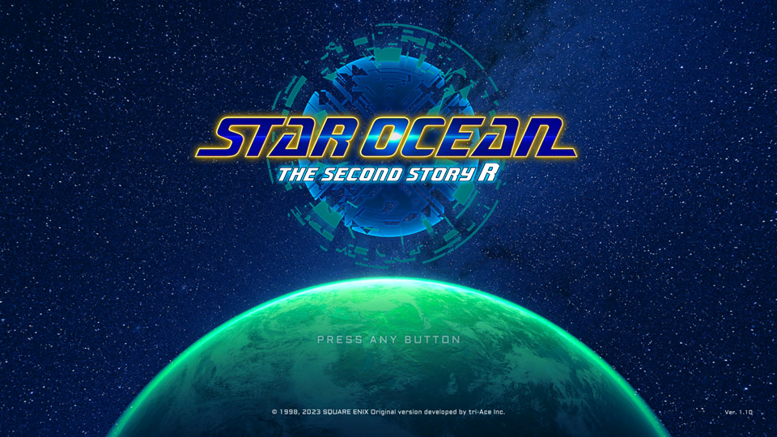 | 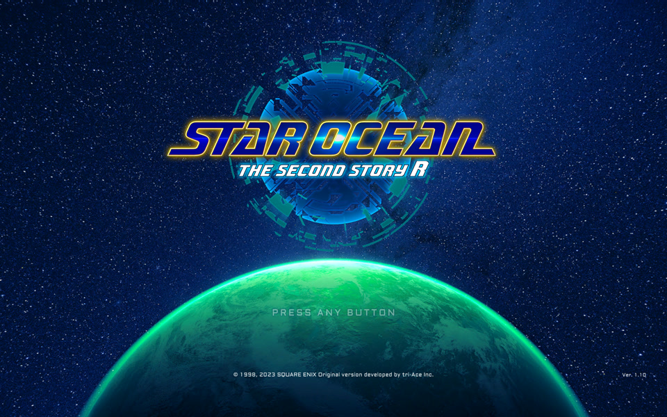 | 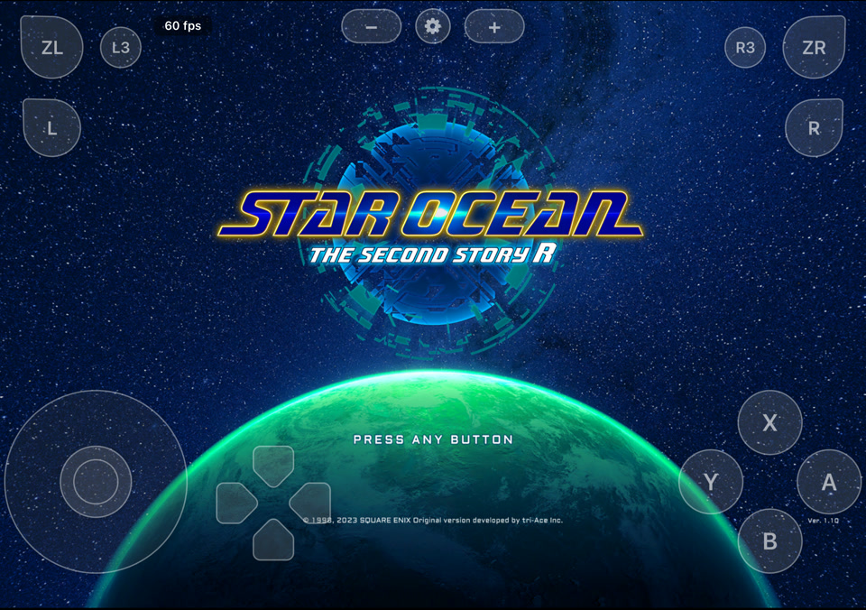 |

## Arlia field and HUD

Same checkpoint and camera, with more scenery above and below. The field hints and minimap stay near the bottom.

| Original 16:9 | MacBook 16:10 |
| --- | --- |
| 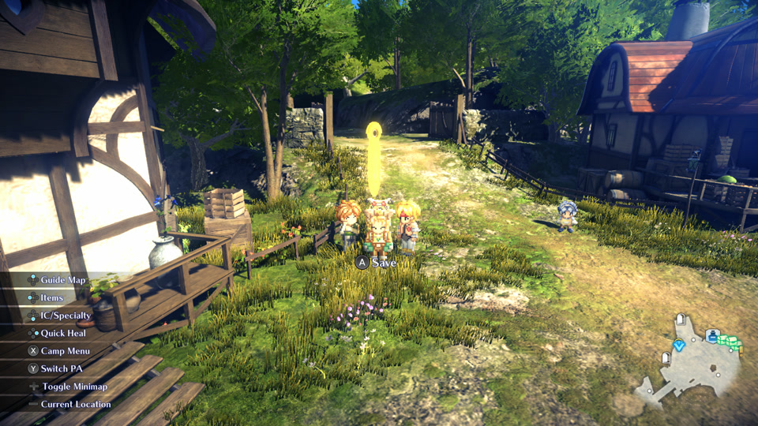 | 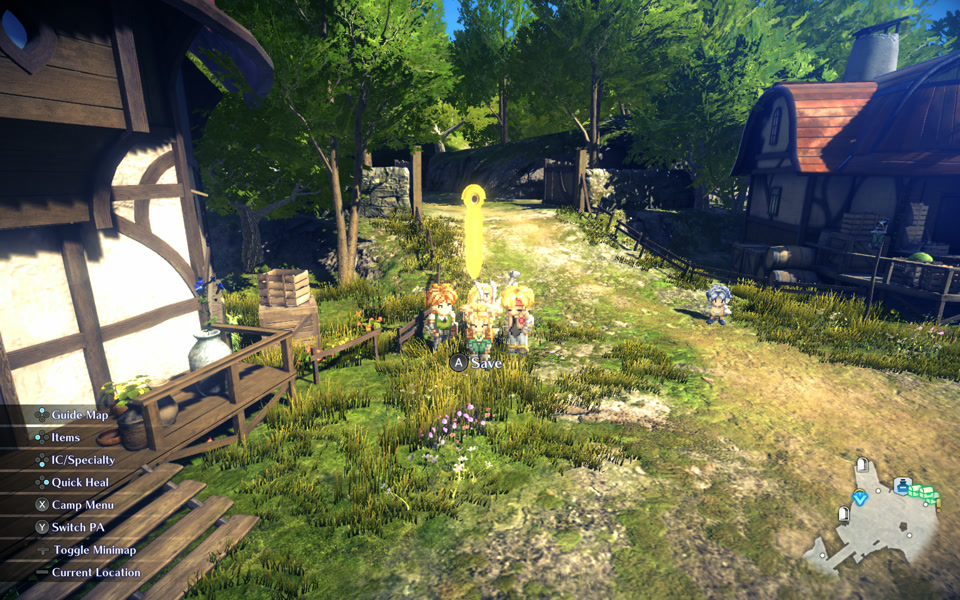 |

## Title menu

The title starfield and planet reach the taller edges without enlarging the logo.

| Original 16:9 | MacBook 16:10 | iPhone Duo 1.43:1 (physical) |
| --- | --- | --- |
|  |  | 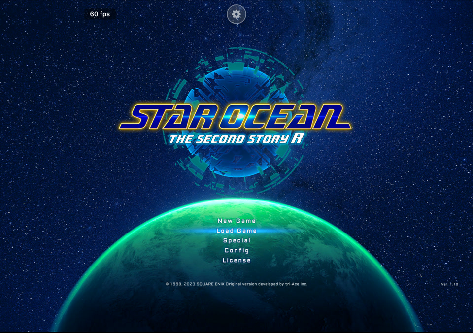 |

## Title → Load

The starfield and blue menu background cover the full view; the save list and button hints stay readable. All three use the same offline test fixture.

| Original 16:9 | MacBook 16:10 | iPhone Duo 1.43:1 (physical) |
| --- | --- | --- |
|  | 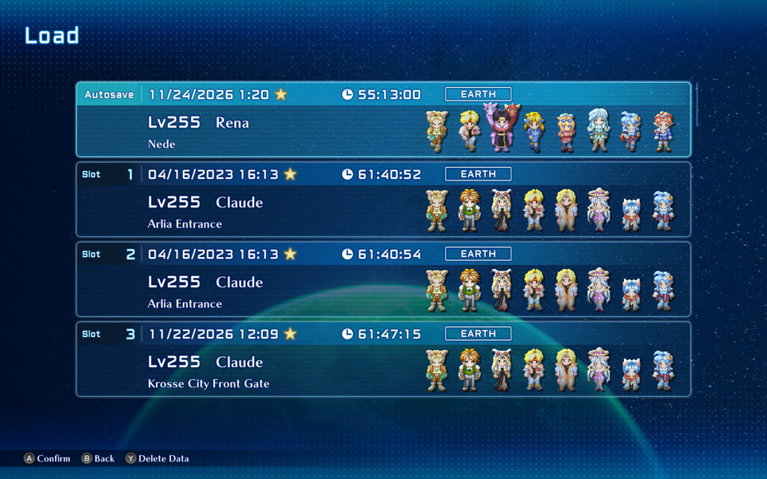 | 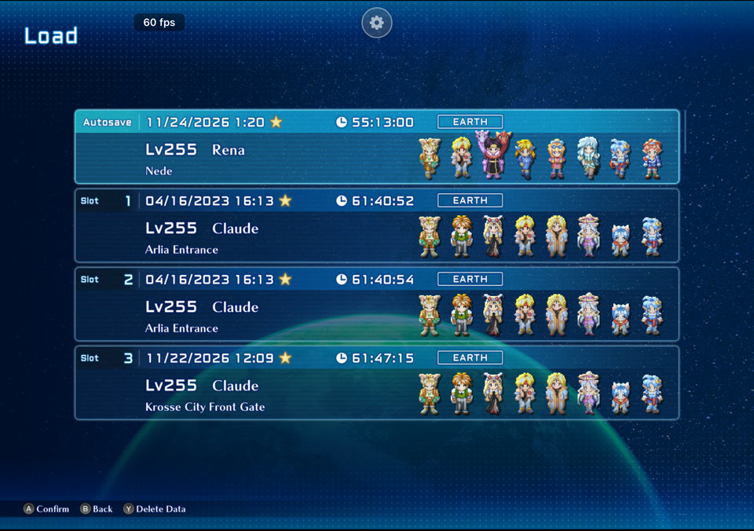 |

## Field → Save

The underlying field is dimmed over the entire taller frame and the footer follows the lower edge.

| Original 16:9 | MacBook 16:10 |
| --- | --- |
|  |  |

## Camp menu

The blue gradient and blurred backdrop cover the new height; the menu header and footer follow the edges.

| Original 16:9 | MacBook 16:10 |
| --- | --- |
|  |  |

## Equipment

The header and button hints move to the new edges. The optional Modern silhouette extension is not included.

| Original 16:9 | MacBook 16:10 |
| --- | --- |
| 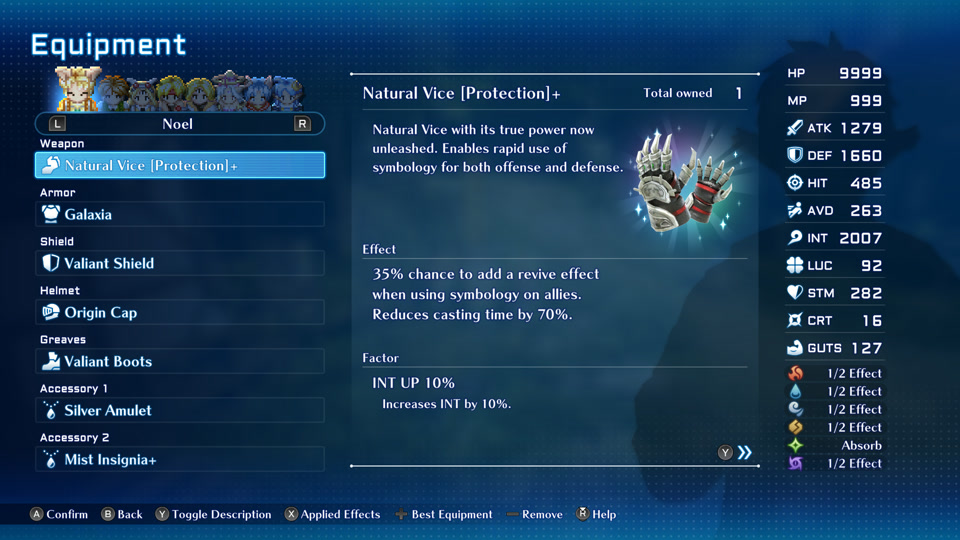 | 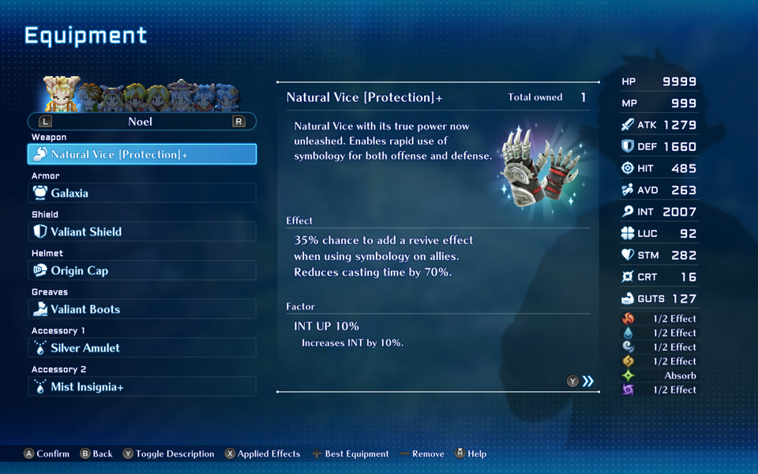 |

## Special Arts / Spells

The header, blue gradient and bottom hints adapt independently of the centered content.

| Original 16:9 | MacBook 16:10 |
| --- | --- |
|  | 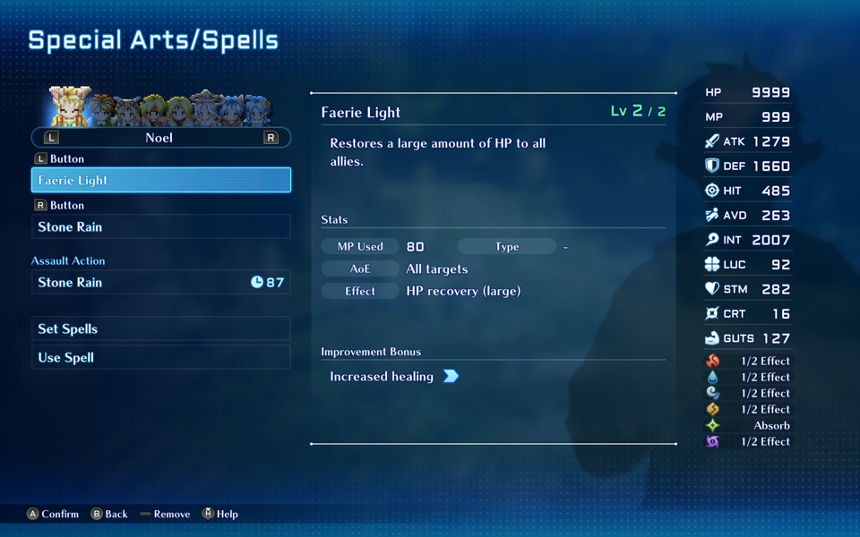 |

## Status

The backdrop and controls adapt. This also shows the known stock portrait cutoff; no altered art is used.

| Original 16:9 | MacBook 16:10 |
| --- | --- |
|  |  |

## Camp → System

The full-height gradient remains in place in a Camp submenu.

| Original 16:9 | MacBook 16:10 |
| --- | --- |
|  |  |

## Camp → Settings

The centered choices keep their size while the heading and footer follow the taller canvas.

| Original 16:9 | MacBook 16:10 |
| --- | --- |
| 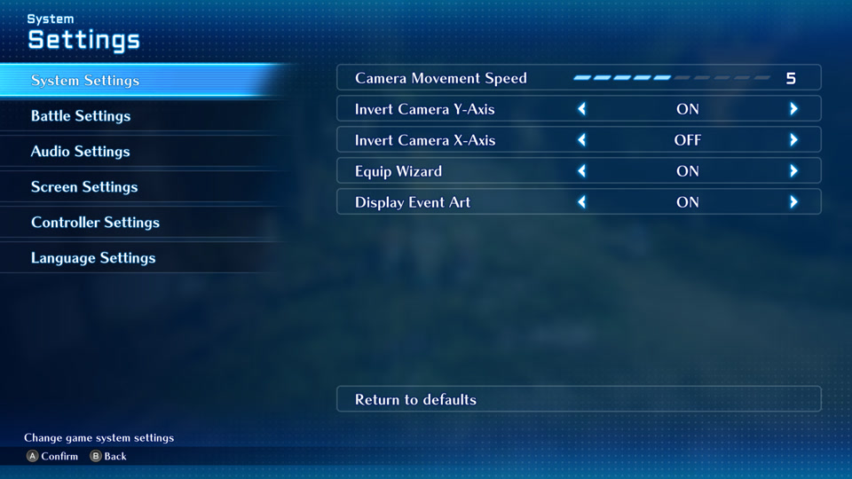 | 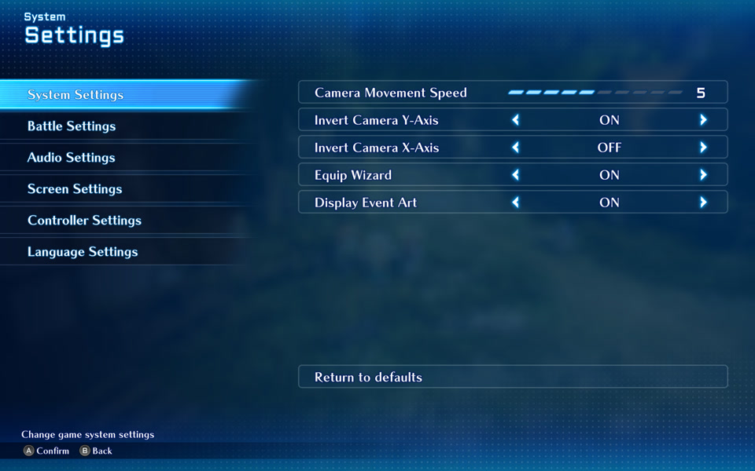 |

## Return to Title confirmation

The dialog stays centered and the dark overlay reaches both edges.

| Original 16:9 | MacBook 16:10 |
| --- | --- |
| 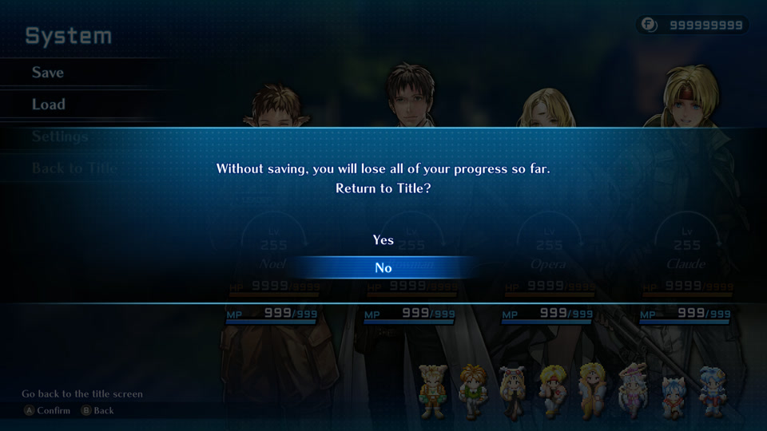 | 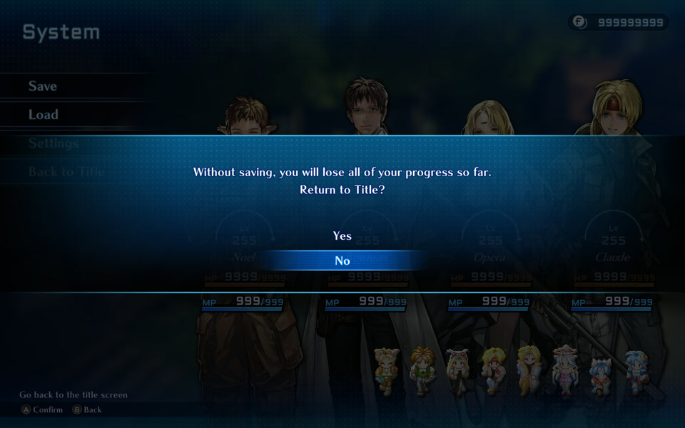 |
